# How xv6 works: flow diagrams

These diagrams follow the code in [xv6/xv6/](../xv6/xv6/), the xv6-riscv tree
described by `book/book-riscv-rev5.pdf`, not older xv6 releases. Two places
where this tree differs from what you may have read elsewhere:

- **No `initcode`.** `userinit()` only allocates a process. The first time any
  process runs `forkret()`, it calls `fsinit()` and then `kexec("/init")`
  directly ([proc.c:513-544](../xv6/xv6/kernel/proc.c#L513-L544)).
- **Sleep API.** Waiting is `sleep_prepare(chan)`, release your own lock, then
  `sleep()`. There is no `sleep(chan, lk)` ([proc.c:548-596](../xv6/xv6/kernel/proc.c#L548-L596)).

To view the diagrams, open the VS Code Markdown preview (the Markdown Preview
Mermaid Support extension renders them) or view the file on GitHub.

## Contents

1. [The whole system on one page](#1-the-whole-system-on-one-page)
2. [Build: from source to kernel and fs.img](#2-build-from-source-to-kernel-and-fsimg)
3. [Boot: power-on to the shell prompt](#3-boot-power-on-to-the-shell-prompt)
4. [Memory: address spaces, page tables, allocator, sbrk](#4-memory-address-spaces-page-tables-allocator-sbrk)
5. [Processes: states, scheduler, context switch](#5-processes-states-scheduler-context-switch)
6. [Traps and interrupts](#6-traps-and-interrupts)
7. [System calls](#7-system-calls)
8. [fork, exec, exit, wait: the shell runs a command](#8-fork-exec-exit-wait-the-shell-runs-a-command)
9. [Locks, sleep and wakeup](#9-locks-sleep-and-wakeup)
10. [File system](#10-file-system)
11. [Pipes](#11-pipes)
12. [Console and UART](#12-console-and-uart)
13. [Where to read the code](#13-where-to-read-the-code)

---

## 1. The whole system on one page

Three layers: user programs, the kernel, and the QEMU `virt` hardware. User
code enters the kernel only through the trampoline page, by a system call
(`ecall`), an interrupt, or an exception.

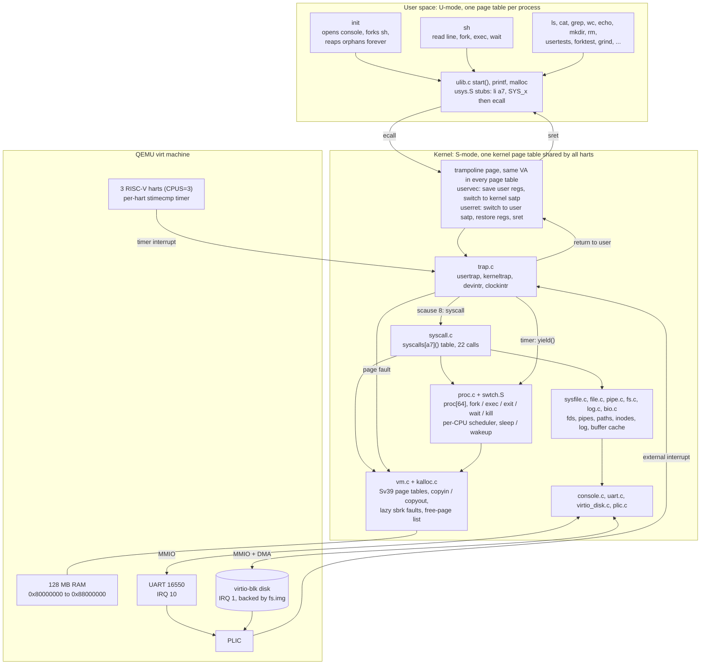

---

## 2. Build: from source to kernel and fs.img

`make qemu` builds two artifacts: the kernel ELF, which QEMU loads at
`0x80000000`, and `fs.img`, a 2000-block file system that holds `README` and
the 20 user programs.

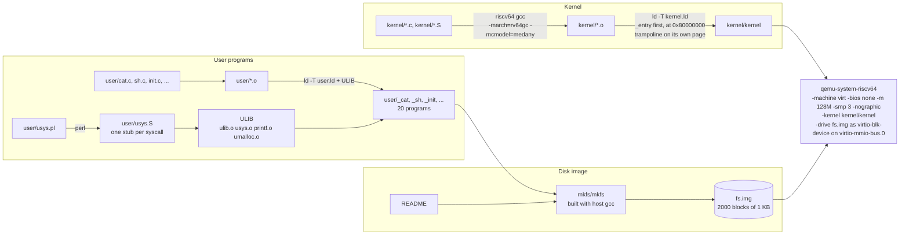

---

## 3. Boot: power-on to the shell prompt

Every hart starts at the same instruction. Hart 0 does all one-time setup
while the others spin on `started`. Then every hart enters its own
`scheduler()` loop, and the first process boots the file system from process
context, because disk I/O has to sleep.

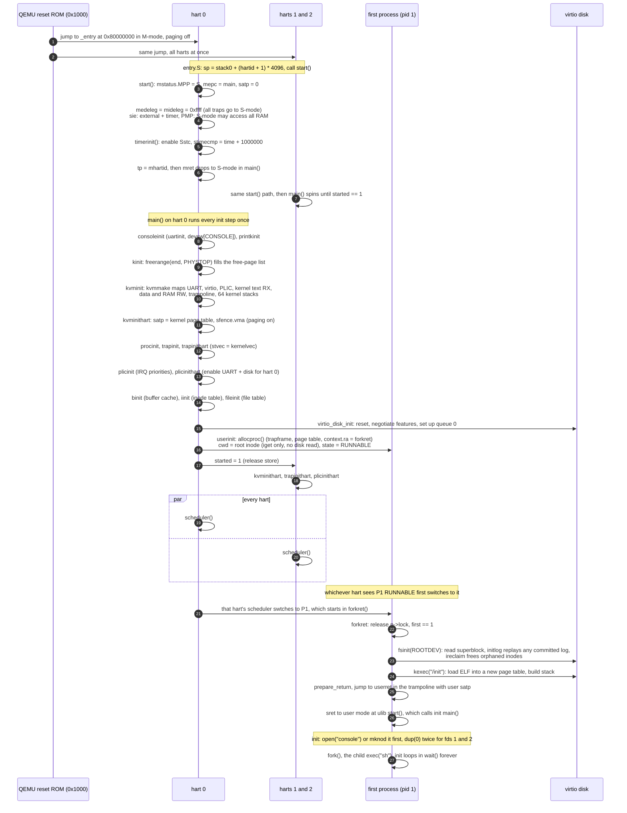

---

## 4. Memory: address spaces, page tables, allocator, sbrk

### 4.1 Physical memory and the two kinds of virtual address space

The kernel identity-maps devices and RAM, so kernel code uses physical
addresses directly. Each process has its own page table. The trampoline page
appears at the same virtual address (`MAXVA - 4096`) in both kinds of page
table, so the trap code keeps running across the `satp` switch.

```mermaid
flowchart LR
    subgraph PHYS["Physical addresses (QEMU virt)"]
        direction TB
        P1["0x00001000 boot ROM"]
        P2["0x02000000 CLINT<br/>(unused: timer is stimecmp)"]
        P3["0x0C000000 PLIC"]
        P4["0x10000000 UART0"]
        P5["0x10001000 virtio disk"]
        P6["0x80000000 kernel text<br/>entry.S first, trampoline page, then etext"]
        P7["kernel data + bss<br/>stack0, cpus[], proc[], bcache, itable, ...<br/>ends at symbol end"]
        P8["free RAM: end to PHYSTOP (0x88000000)<br/>every page handed out by kalloc()"]
        P1 ~~~ P2 ~~~ P3 ~~~ P4 ~~~ P5 ~~~ P6 ~~~ P7 ~~~ P8
    end

    subgraph KVA["Kernel virtual (kernel_pagetable, all harts)"]
        direction TB
        K1["MAXVA - 4096: TRAMPOLINE (R X)<br/>maps the trampoline page in kernel text"]
        K2["KSTACK(0..63): 1 page each (R W)<br/>with an unmapped guard page between stacks"]
        K3["... unmapped ..."]
        K4["0x80000000 to etext: kernel text (R X)<br/>etext to PHYSTOP: data + free RAM (R W)<br/>identity mapped"]
        K5["PLIC, UART0, virtio<br/>identity mapped (R W)"]
        K1 ~~~ K2 ~~~ K3 ~~~ K4 ~~~ K5
    end

    subgraph UVA["User virtual (p->pagetable, one per process)"]
        direction TB
        U1["MAXVA - 4096: TRAMPOLINE (R X, no U)<br/>same physical page as the kernel's"]
        U2["TRAPFRAME (R W, no U)<br/>this process's p->trapframe page"]
        U3["... unmapped ..."]
        U4["heap up to p->sz<br/>sbrk maps now, sbrklazy maps on first touch"]
        U5["user stack: USERSTACK = 1 page (R W U)"]
        U6["guard page (PTE_U cleared by uvmclear)"]
        U7["data + bss (R W U)"]
        U8["0x0: text (R X U)<br/>entry point = ulib.c start()"]
        U1 ~~~ U2 ~~~ U3 ~~~ U4 ~~~ U5 ~~~ U6 ~~~ U7 ~~~ U8
    end
```

### 4.2 Sv39 address translation

The hardware walks this tree on every TLB miss. `walk()` in vm.c does the same
walk in software when the kernel builds or reads page tables. `MAXVA` is
`2^38`, one bit below the Sv39 limit, so addresses never need sign extension.

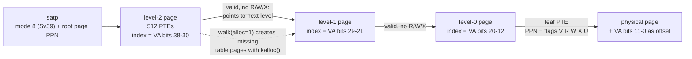

### 4.3 Physical page allocator

There is one free list of 4 KB pages, protected by one spinlock. Every
dynamic kernel allocation is a whole page.

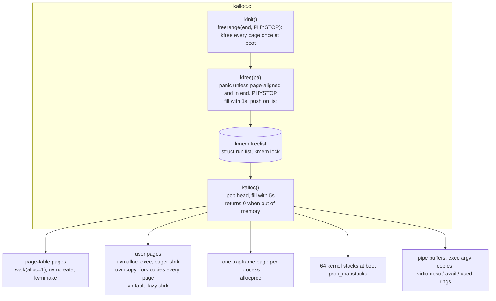

### 4.4 Growing memory: eager and lazy sbrk

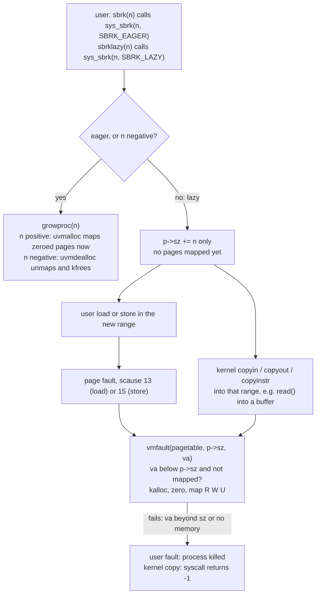

---

## 5. Processes: states, scheduler, context switch

### 5.1 Process states

`p->state` is protected by `p->lock`. A process is killed by setting
`p->killed`. It exits the next time it reaches a check point in `usertrap()`
or in a sleep loop that tests `killed()`.

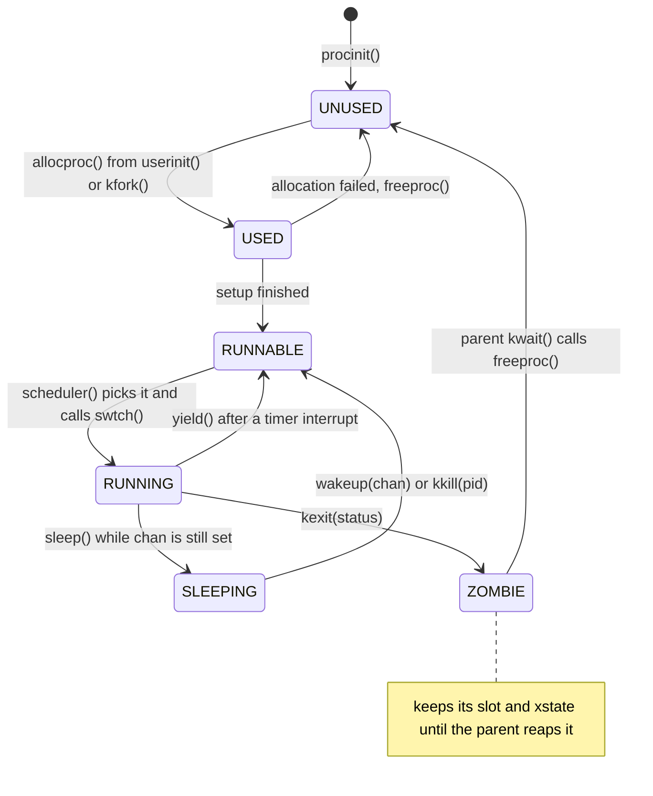

### 5.2 The scheduler and swtch

Each CPU runs `scheduler()` on its boot stack. A process never switches
directly to another process: it switches to its CPU's scheduler thread, which
switches to the next one. `p->lock` is held across the switch in both
directions. `swtch` saves only `ra`, `sp` and `s0`-`s11`; the caller-saved
registers were already saved by the C calling convention.

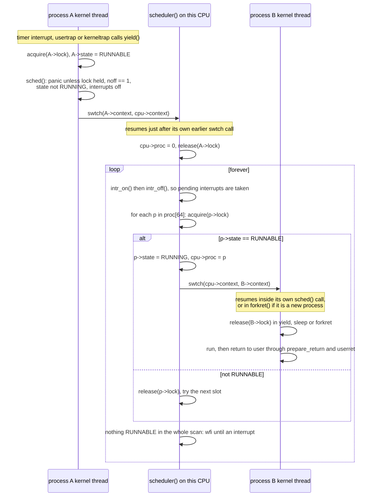

---

## 6. Traps and interrupts

### 6.1 From user space into the kernel and back

`stvec` points at `uservec` while user code runs and at `kernelvec` while
kernel code runs. `usertrap()` changes it on entry and `prepare_return()`
changes it back.

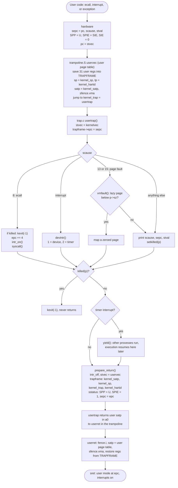

### 6.2 Traps taken while already in the kernel

Kernel code never page-faults on purpose, so any exception in S-mode is a
panic. Only device and timer interrupts are expected.

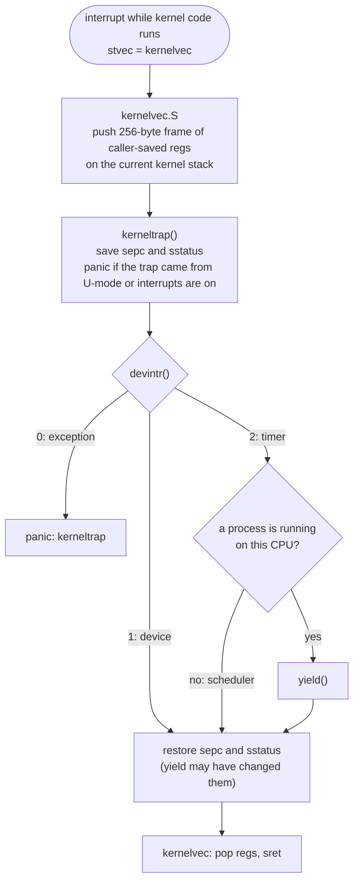

### 6.3 Interrupt sources and devintr()

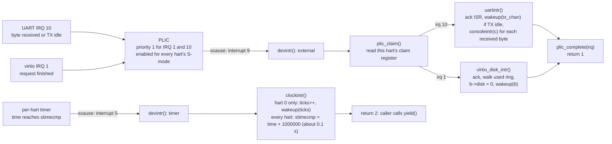

---

## 7. System calls

A system call is an `ecall` with the call number in `a7` and arguments in
`a0`-`a5`. The return value goes back in `a0`. Kernel code never dereferences
user pointers directly: it uses `copyin` and `copyout`, which walk the user
page table and check addresses against `p->sz`.

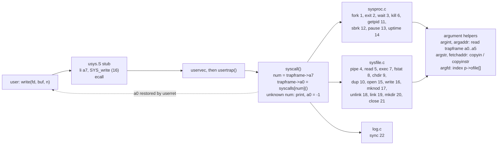

---

## 8. fork, exec, exit, wait: the shell runs a command

What happens when you type `ls` at the `$` prompt. `fork` copies all user
memory eagerly. `exec` builds the new image in a fresh page table and only
discards the old one once nothing can fail.

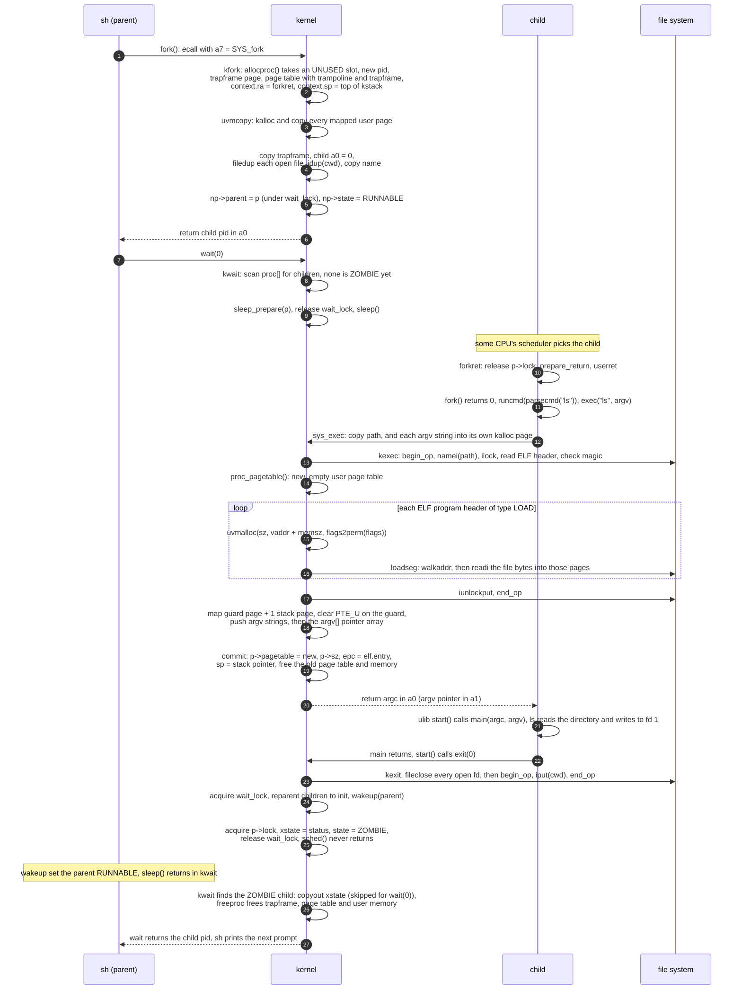

---

## 9. Locks, sleep and wakeup

### 9.1 Spinlocks

`acquire()` disables interrupts before it spins, so an interrupt handler on
the same CPU can never deadlock against the code it interrupted. `push_off()`
and `pop_off()` nest, and interrupts come back on only when the outermost
lock is released.

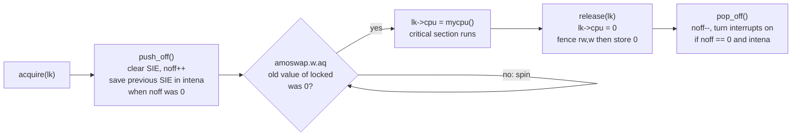

Sleep locks (`sleeplock.c`) are a spinlock plus a `locked` flag. A waiter
sleeps on the lock's address, so they can be held across disk I/O. Inodes,
buffers and the UART transmitter use them.

| Lock | Kind | Protects | File |
|---|---|---|---|
| `kmem.lock` | spin | free page list | kalloc.c |
| `pid_lock` | spin | `nextpid` | proc.c |
| `wait_lock` | spin | every `p->parent`, the exit/wait handoff. Acquire before any `p->lock` | proc.c |
| `p->lock` | spin | `state`, `chan`, `killed`, `xstate`, `pid`. Held across `swtch` | proc.c |
| `tickslock` | spin | `ticks` | trap.c |
| `cons.lock` | spin | console input buffer | console.c |
| `tx_lock` | sleep | one writer at a time in `uartwrite` | uart.c |
| `pr.lock` | spin | keeps concurrent `printk` output from interleaving | printk.c |
| `ftable.lock` | spin | `struct file` reference counts | file.c |
| `pi->lock` | spin | one pipe's buffer and counters | pipe.c |
| `itable.lock` | spin | inode table slots: `ref`, `dev`, `inum` | fs.c |
| `ip->lock` | sleep | one inode's contents: `valid`, `type`, `size`, `addrs` | fs.c |
| `log.lock` | spin | log header, `outstanding`, `committing` | log.c |
| `bcache.lock` | spin | buffer list, `refcnt`, which block a buffer holds | bio.c |
| `b->lock` | sleep | one buffer's data | bio.c |
| `disk.vdisk_lock` | spin | virtio descriptors, rings, `info[]` | virtio_disk.c |

### 9.2 sleep_prepare, sleep, wakeup: why no wakeup is lost

The waiter registers its channel before it drops the lock that protects the
condition. `wakeup()` clears `p->chan`, so a wakeup that arrives between the
release and `sleep()` makes `sleep()` return at once and is not lost. The
example uses a pipe, but disk I/O, `wait`, `pause`, the console and the log
all follow the same pattern.

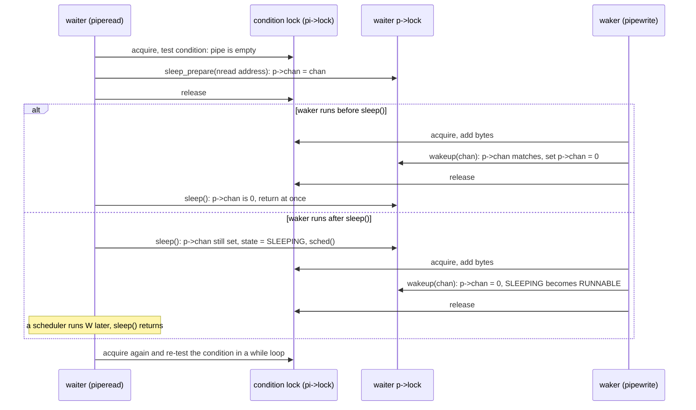

---

## 10. File system

### 10.1 Layers

Each layer uses only the one below it. Every system call that modifies the
disk wraps its work in `begin_op()` and `end_op()`, so the whole call commits
atomically.

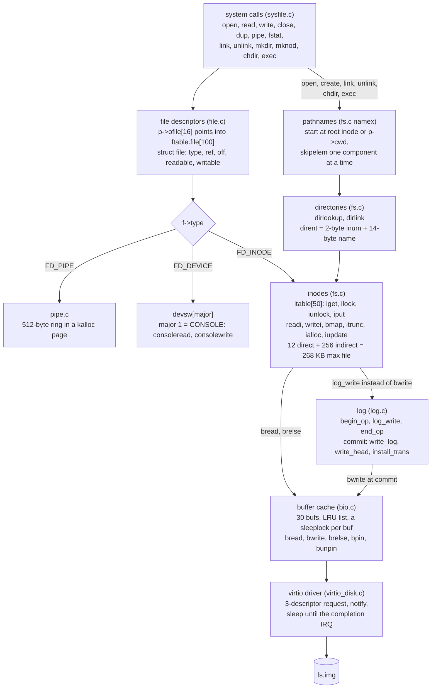

### 10.2 On-disk layout

Built by `mkfs` from `param.h` and `fs.h`: `FSSIZE = 2000` blocks of 1 KB.
`mkfs` prints `nmeta 47 (boot, super, log blocks 31, inode blocks 13, bitmap
blocks 1) blocks 1953 total 2000`.

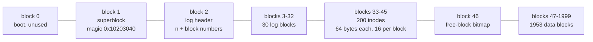

### 10.3 Reading a file: `read(fd, buf, n)` with a cache miss

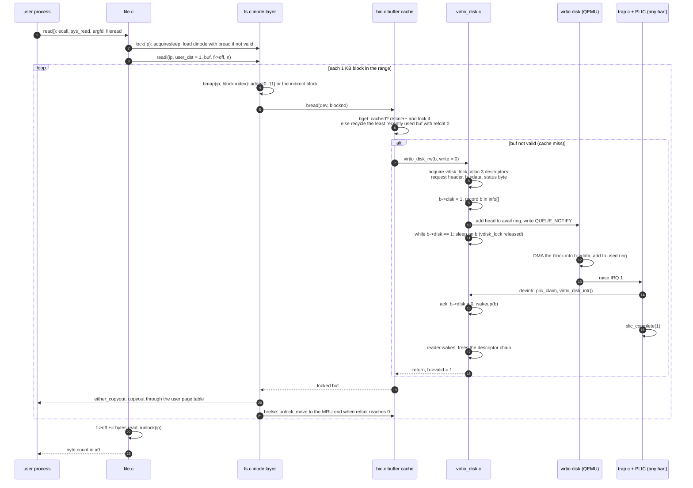

### 10.4 Writing a file and committing the log

`filewrite()` splits a large write into transactions of at most 3072 bytes.
A non-aligned chunk can touch 4 data blocks, and with the inode, indirect and
bitmap blocks it still fits in one op's 10-block budget. `begin_op()`
reserves `MAXOPBLOCKS = 10` log blocks for each running FS call, so at most
three calls run in a transaction at once.

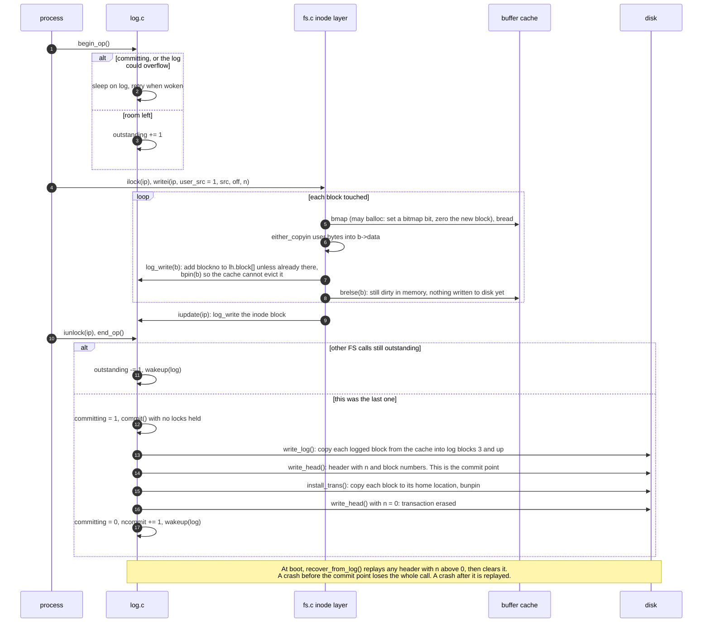

---

## 11. Pipes

A pipe is two `struct file`s, one read end and one write end, that share one
`kalloc` page holding the counters and a 512-byte ring. `nread` and `nwrite`
only increase, so the buffer is full when `nwrite == nread + 512`.

```mermaid
flowchart LR
    subgraph WR["pipewrite(addr, n)"]
        W0{"read end closed<br/>or killed?"} -->|"yes"| WX["return -1"]
        W0 -->|"no"| W1{"buffer full?"}
        W1 -->|"yes"| W2["wakeup(nread)<br/>sleep on nwrite"]
        W2 --> W0
        W1 -->|"no"| W3["copyin 1 byte<br/>data[nwrite++ mod 512]"]
        W3 --> W4{"more bytes?"}
        W4 -->|"yes"| W0
        W4 -->|"no"| W5["wakeup(nread)<br/>return n"]
    end
    subgraph RD["piperead(addr, n)"]
        R1{"empty and<br/>write end open?"} -->|"yes"| R2["sleep on nread<br/>(return -1 if killed)"]
        R2 --> R1
        R1 -->|"no"| R3["copyout up to n bytes"]
        R3 --> R4["wakeup(nwrite)<br/>return count, 0 means EOF"]
    end
```

`pipeclose()` clears `readopen` or `writeopen` and wakes the other side. The
page is freed when both ends are closed.

---

## 12. Console and UART

Input is interrupt-driven and line-buffered. Output from `write()` sleeps
while the UART is busy. Kernel `printk` bypasses both paths: it calls
`uartputc_sync()`, which spins with interrupts off, so it works inside
interrupt handlers and during a panic.

```mermaid
sequenceDiagram
    participant KB as terminal
    participant UART as UART 16550
    participant ISR as uartintr + consoleintr
    participant RD as reader (sh in consoleread)
    participant WR as writer (printf in consolewrite)

    KB->>UART: byte arrives in RHR
    UART->>ISR: IRQ 10 through the PLIC, devintr
    ISR->>ISR: uartgetc loop, consoleintr(c) under cons.lock
    ISR->>UART: echo with consputc and uartputc_sync
    Note over ISR: ctrl-H or DEL erases, ctrl-U kills the line,<br/>ctrl-P prints the process list, ctrl-D is end of file
    ISR->>RD: on newline, ctrl-D or a full 128-byte buffer:<br/>cons.w = cons.e, wakeup(cons.r)
    RD->>RD: copy bytes from cons.buf to user memory up to the newline
    WR->>WR: either_copyin 32 bytes at a time, uartwrite takes tx_lock
    loop each byte
        alt LSR reports TX idle
            WR->>UART: write the byte to THR
        else UART busy
            WR->>WR: sleep on tx_chan
            UART->>ISR: TX-idle interrupt
            ISR->>WR: wakeup(tx_chan)
        end
    end
```

---

## 13. Where to read the code

| Topic | Functions | Code |
|---|---|---|
| Boot | `_entry`, `start`, `timerinit`, `main` | [entry.S:7](../xv6/xv6/kernel/entry.S#L7), [start.c:15](../xv6/xv6/kernel/start.c#L15), [main.c:11](../xv6/xv6/kernel/main.c#L11) |
| First process | `userinit`, `forkret`, init `main` | [proc.c:219](../xv6/xv6/kernel/proc.c#L219), [proc.c:513](../xv6/xv6/kernel/proc.c#L513), [init.c:15](../xv6/xv6/user/init.c#L15) |
| Memory layout | constants | [memlayout.h](../xv6/xv6/kernel/memlayout.h), [param.h](../xv6/xv6/kernel/param.h) |
| Page tables | `kvmmake`, `walk`, `mappages`, `uvmalloc`, `uvmcopy` | [vm.c:22](../xv6/xv6/kernel/vm.c#L22), [vm.c:99](../xv6/xv6/kernel/vm.c#L99), [vm.c:147](../xv6/xv6/kernel/vm.c#L147), [vm.c:218](../xv6/xv6/kernel/vm.c#L218), [vm.c:299](../xv6/xv6/kernel/vm.c#L299) |
| User copies, lazy faults | `copyout`, `copyin`, `vmfault` | [vm.c:345](../xv6/xv6/kernel/vm.c#L345), [vm.c:383](../xv6/xv6/kernel/vm.c#L383), [vm.c:459](../xv6/xv6/kernel/vm.c#L459) |
| Allocator | `kinit`, `kfree`, `kalloc` | [kalloc.c:27](../xv6/xv6/kernel/kalloc.c#L27) |
| sbrk | `sys_sbrk`, `growproc` | [sysproc.c:40](../xv6/xv6/kernel/sysproc.c#L40), [proc.c:236](../xv6/xv6/kernel/proc.c#L236) |
| Process table | `struct proc`, `allocproc`, `freeproc` | [proc.h:82](../xv6/xv6/kernel/proc.h#L82), [proc.c:110](../xv6/xv6/kernel/proc.c#L110), [proc.c:156](../xv6/xv6/kernel/proc.c#L156) |
| Scheduling | `scheduler`, `sched`, `yield`, `swtch` | [proc.c:429](../xv6/xv6/kernel/proc.c#L429), [proc.c:480](../xv6/xv6/kernel/proc.c#L480), [proc.c:501](../xv6/xv6/kernel/proc.c#L501), [swtch.S:9](../xv6/xv6/kernel/swtch.S#L9) |
| fork, exit, wait, kill | `kfork`, `kexit`, `kwait`, `kkill` | [proc.c:259](../xv6/xv6/kernel/proc.c#L259), [proc.c:326](../xv6/xv6/kernel/proc.c#L326), [proc.c:370](../xv6/xv6/kernel/proc.c#L370), [proc.c:602](../xv6/xv6/kernel/proc.c#L602) |
| exec | `kexec`, `loadseg` | [exec.c:28](../xv6/xv6/kernel/exec.c#L28), [exec.c:157](../xv6/xv6/kernel/exec.c#L157) |
| User traps | `uservec`, `userret`, `usertrap`, `prepare_return` | [trampoline.S:22](../xv6/xv6/kernel/trampoline.S#L22), [trampoline.S:101](../xv6/xv6/kernel/trampoline.S#L101), [trap.c:38](../xv6/xv6/kernel/trap.c#L38), [trap.c:101](../xv6/xv6/kernel/trap.c#L101) |
| Kernel traps, interrupts | `kernelvec`, `kerneltrap`, `devintr`, `clockintr`, PLIC | [kernelvec.S:12](../xv6/xv6/kernel/kernelvec.S#L12), [trap.c:137](../xv6/xv6/kernel/trap.c#L137), [trap.c:188](../xv6/xv6/kernel/trap.c#L188), [trap.c:167](../xv6/xv6/kernel/trap.c#L167), [plic.c](../xv6/xv6/kernel/plic.c) |
| System calls | stubs, `syscall`, argument helpers | [usys.pl](../xv6/xv6/user/usys.pl), [syscall.c:137](../xv6/xv6/kernel/syscall.c#L137), [syscall.c:35](../xv6/xv6/kernel/syscall.c#L35) |
| Locks | `acquire`, `release`, `push_off`, sleep locks | [spinlock.c:22](../xv6/xv6/kernel/spinlock.c#L22), [spinlock.c:93](../xv6/xv6/kernel/spinlock.c#L93), [sleeplock.c:22](../xv6/xv6/kernel/sleeplock.c#L22) |
| Sleep and wakeup | `sleep_prepare`, `sleep`, `wakeup` | [proc.c:548](../xv6/xv6/kernel/proc.c#L548), [proc.c:563](../xv6/xv6/kernel/proc.c#L563), [proc.c:577](../xv6/xv6/kernel/proc.c#L577) |
| File syscalls | `sys_open`, `create`, `sys_exec`, `sys_pipe` | [sysfile.c:329](../xv6/xv6/kernel/sysfile.c#L329), [sysfile.c:259](../xv6/xv6/kernel/sysfile.c#L259), [sysfile.c:459](../xv6/xv6/kernel/sysfile.c#L459), [sysfile.c:502](../xv6/xv6/kernel/sysfile.c#L502) |
| File table | `fileread`, `filewrite`, `fileclose` | [file.c:107](../xv6/xv6/kernel/file.c#L107), [file.c:135](../xv6/xv6/kernel/file.c#L135), [file.c:60](../xv6/xv6/kernel/file.c#L60) |
| Inodes, directories, paths | `ilock`, `iput`, `bmap`, `readi`, `writei`, `dirlookup`, `namex` | [fs.c:295](../xv6/xv6/kernel/fs.c#L295), [fs.c:350](../xv6/xv6/kernel/fs.c#L350), [fs.c:421](../xv6/xv6/kernel/fs.c#L421), [fs.c:510](../xv6/xv6/kernel/fs.c#L510), [fs.c:544](../xv6/xv6/kernel/fs.c#L544), [fs.c:592](../xv6/xv6/kernel/fs.c#L592), [fs.c:692](../xv6/xv6/kernel/fs.c#L692) |
| Log | `begin_op`, `end_op`, `commit`, `log_write`, recovery | [log.c:129](../xv6/xv6/kernel/log.c#L129), [log.c:155](../xv6/xv6/kernel/log.c#L155), [log.c:203](../xv6/xv6/kernel/log.c#L203), [log.c:224](../xv6/xv6/kernel/log.c#L224), [log.c:119](../xv6/xv6/kernel/log.c#L119) |
| Buffer cache | `bget`, `bread`, `brelse` | [bio.c:58](../xv6/xv6/kernel/bio.c#L58), [bio.c:92](../xv6/xv6/kernel/bio.c#L92), [bio.c:117](../xv6/xv6/kernel/bio.c#L117) |
| Disk driver | `virtio_disk_rw`, `virtio_disk_intr` | [virtio_disk.c:216](../xv6/xv6/kernel/virtio_disk.c#L216), [virtio_disk.c:301](../xv6/xv6/kernel/virtio_disk.c#L301) |
| Disk image | `mkfs` | [mkfs.c](../xv6/xv6/mkfs/mkfs.c) |
| Pipes | `pipewrite`, `piperead`, `pipeclose` | [pipe.c:77](../xv6/xv6/kernel/pipe.c#L77), [pipe.c:112](../xv6/xv6/kernel/pipe.c#L112), [pipe.c:59](../xv6/xv6/kernel/pipe.c#L59) |
| Console, UART | `consoleintr`, `consoleread`, `uartwrite`, `uartintr` | [console.c:147](../xv6/xv6/kernel/console.c#L147), [console.c:88](../xv6/xv6/kernel/console.c#L88), [uart.c:80](../xv6/xv6/kernel/uart.c#L80), [uart.c:139](../xv6/xv6/kernel/uart.c#L139) |
| Shell | `main`, `runcmd`, `parsecmd` | [sh.c:146](../xv6/xv6/user/sh.c#L146), [sh.c:59](../xv6/xv6/user/sh.c#L59), [sh.c:334](../xv6/xv6/user/sh.c#L334) |
